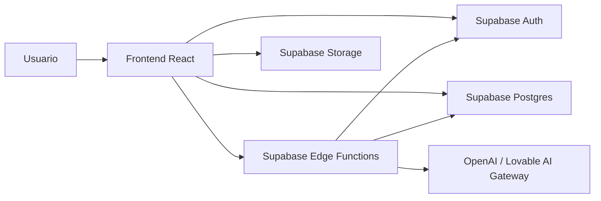

# Documentacao Tecnica do Sistema

## 1. Visao Geral

O `process-ai-suite` e um SaaS multiempresa para mapeamento, diagnostico e documentacao de processos com apoio de IA. O sistema combina frontend React, backend serverless via Supabase Edge Functions, banco PostgreSQL com RLS e armazenamento de artefatos no Supabase Storage.

O produto atende dois cenarios principais:

- Consultoria: um usuario pode possuir ou acessar multiplas empresas.
- B2B corporativo: uma empresa disponibiliza a plataforma para seus colaboradores.

Capacidades centrais:

- cadastro e selecao de empresas
- convite e aceite de usuarios por empresa
- mapeamento de processos via formulario e via entrevista com IA
- diagnostico operacional e BPMN AS IS / TO BE
- configuracao de comportamento da IA por empresa
- configuracao documental por empresa
- geracao, revisao, aprovacao e publicacao de documentos
- help center com IA contextual
- abertura e acompanhamento de chamados

## 2. Stack Tecnologica

### Frontend

- React 18
- TypeScript
- Vite
- React Router
- TanStack Query
- Tailwind CSS
- shadcn/ui
- `bpmn-js` para edicao/visualizacao BPMN
- `pdfjs-dist`, `mammoth` e `tesseract.js` para leitura e tratamento de documentos

### Backend e Infra

- Supabase Auth
- Supabase Postgres
- Supabase Storage
- Supabase Edge Functions em Deno
- RLS para isolamento por empresa
- OpenAI e/ou gateway Lovable para recursos de IA

## 3. Arquitetura de Alto Nivel

### Componentes principais

- Frontend:
  - roteamento, formularios, listas, dashboards e experiencias de chat
- Banco:
  - guarda entidades operacionais, configuracoes, convites, sessoes e documentos
- Edge Functions:
  - encapsulam fluxos de negocio e integracoes externas
- Storage:
  - arquivos anexos de chamados

## 4. Estrutura Funcional do Frontend

### Rotas principais

- `/`: landing page
- `/login`: autenticacao
- `/reset-password`: redefinicao de senha
- `/convite/:token`: aceite de convite
- `/dashboard`: painel principal
- `/empresas`: cadastro e gestao de empresas
- `/processos`: listagem de processos
- `/processos/novo`: hub de criacao
- `/processos/novo/formulario`: formulario estruturado
- `/processos/novo/entrevista`: entrevista com Peter
- `/processos/diagnostico`: diagnostico operacional
- `/processos/:id`: detalhe do processo
- `/processos/:id/editar`: edicao do processo
- `/processos/:id/diagnostico`: diagnostico por processo salvo
- `/documentos`: operacao documental
- `/configuracoes/documentacao-processo`: configuracao documental
- `/configuracoes/usuarios`: membros e convites
- `/configuracoes/empresas`: empresas
- `/configuracoes/roteiro-entrevista`: roteiro de IA
- `/configuracoes/skin-ia`: persona e regras da IA
- `/configuracoes/chamados`: chamados
- `/configuracoes/chamados/:id`: detalhe do chamado

### Layout e navegacao

- `AppLayout` fornece estrutura principal autenticada.
- `AppSidebar` carrega empresas via `org-list`, persiste a empresa ativa em `localStorage` e abastece o seletor "Empresa Atual".
- `SupportWidget` fica disponivel globalmente para ajuda contextual via IA.
- `App.tsx` possui `ErrorBoundary` global para falhas de renderizacao.

## 5. Modulos e Features

### 5.1 Empresas

Objetivo:

- cadastrar e listar empresas acessiveis ao usuario
- suportar multiplas empresas por conta

Funcionamento:

- a tela chama `org-list` para carregar empresas acessiveis
- o cadastro usa `org-onboarding`
- no onboarding automatico, a plataforma pode criar empresa com base no `user_metadata`

Dados relevantes:

- `empresas.nome`
- `empresas.segmento`
- `empresas.tamanho`
- `empresas.area_atuacao`
- `empresas.contexto`
- `empresas.owner_id`

### 5.2 Usuarios, Convites e Acesso Organizacional

Objetivo:

- administrar membros por empresa
- convidar novos usuarios
- aceitar ou revogar convites

Perfis implementados em `membros.perfil`:

- `admin`
- `gestor`
- `analista`

Observacao:

- `owner` nao fica em `membros`; ele e derivado de `empresas.owner_id`

Fluxo de convite:

1. usuario autorizado envia convite pela tela de usuarios
2. frontend chama `org-invite`
3. edge function cria ou reaproveita convite pendente
4. email real pode ser enviado por Resend ou SMTP
5. usuario acessa `/convite/:token`
6. `org-accept-invite` valida token
7. apos login correto, cria registro em `membros`
8. convite passa para `accepted`

Fluxos de suporte:

- `org-members`: lista membros, usuarios e convites
- `org-revoke-invite`: cancela convite pendente

### 5.3 Processos

Objetivo:

- registrar o mapeamento completo do processo
- manter entrevista, formulario, diagnostico e estado BPMN no mesmo registro

Status de processo:

- `Rascunho`
- `Em revisão`
- `Aprovado`
- `Publicado`
- `Obsoleto`

Entradas do modulo:

- formulario manual
- entrevista com IA
- diagnostico operacional
- mapas BPMN AS IS e TO BE

Comportamento:

- a listagem em `Processos.tsx` busca diretamente da tabela `processos`
- `ProcessoFormulario.tsx` carrega e salva o registro principal na tabela `processos`
- `EntrevistaProcesso.tsx` persiste rascunhos, historico de mensagens e sessao relacionada
- `ProcessoDiagnostico.tsx` continua o fluxo no mesmo processo salvo
- `ProcessoDetalhe.tsx` exibe um processo por `id` e `company_id`

Campos de negocio importantes do processo:

- identificacao: nome, area, responsavel, entrevistados, classificacao
- contexto: objetivo, cliente do processo, areas envolvidas, gatilho
- operacao: entradas, etapas, saidas, decisoes, recursos
- risco e performance: riscos, indicadores, plano de acao, oportunidades
- modelagem: BPMN AS IS, BPMN TO BE
- analise: diagnostico JSON
- governanca: status, criticidade, revisao e aprovacao do mapa

### 5.4 Entrevista com IA

Objetivo:

- conduzir descoberta assistida do processo por conversa

Agente:

- Peter, configuravel por empresa

Fluxo:

1. pagina resolve empresa ativa
2. `useAiConfig("route_script")` carrega configuracao de IA da empresa
3. a conversa inicia com acolhimento, coleta do nome da pessoa e do nome do processo
4. o usuario fornece um "textao" inicial do processo
5. a edge `ai-interview` responde com JSON estruturado
6. `partialUpdate` atualiza o `ProcessoFormData`
7. o estado e persistido em `interview_sessions` e `processos`

Blindagens atuais:

- fallback para defaults de IA quando `useAiConfig` falha
- protecao de inicializacao quando nao ha empresa ativa
- `ErrorBoundary` local
- tratamento de erro amigavel para falhas da edge function

### 5.5 Configuracao de IA

Objetivo:

- personalizar o comportamento da IA por empresa

Tipos atuais em `ai_configurations.config_type`:

- `route_script`
- `skin_identity`
- `skin_validation`

Uso:

- `useAiConfig.ts` resolve empresa ativa
- busca configuracao por `company_id`
- se nao houver dado ou houver falha, usa `AI_CONFIG_DEFAULTS`

Consumidores:

- `ai-interview`
- `ai-fill-process`
- `ai-diagnose-process`
- telas de configuracao de roteiro e skin

### 5.6 Documentacao de Processo

O dominio documental possui dois modulos complementares:

- modulo operacional em `/documentos`
- modulo de configuracao em `/configuracoes/documentacao-processo`

#### Configuracao documental

Objetivo:

- configurar modelos, secoes, prompts, variaveis e politicas de geracao por empresa

Entidades:

- templates
- secoes do template
- prompts do template
- variaveis do template
- configuracao global de geracao por empresa

Capacidades:

- templates do sistema e templates da empresa
- definicao de secoes obrigatorias
- prompts de geracao
- controles de IA, indexacao, embeddings, checklist e FAQ
- definicao de template padrao

#### Operacao documental

Objetivo:

- gerar e manter documentos operacionais

Modos de origem:

- `linked_process`: documento vinculado a processo aprovado
- `independent`: documento independente

Regras atuais:

- ao vincular processo, a origem e a tabela `processos`
- a selecao considera processos com status `Aprovado`
- se nao houver processo aprovado, a UI exibe:
  - `Nenhum processo aprovado encontrado. Aprove um processo antes de vincular.`

Capacidades:

- gerar documento via IA
- editar documento em rascunho ou revisao
- aprovar, publicar e tornar obsoleto
- manter historico de revisao e distribuicao
- vincular revisao do mapa aprovado ao documento gerado

Status do documento:

- `Rascunho`
- `Em revisão`
- `Em aprovação`
- `Publicado`
- `Obsoleto`

### 5.7 Chamados

Objetivo:

- atender suporte operacional da plataforma

Capacidades:

- abertura de chamado
- classificacao por tipo
- anexo em bucket privado
- atualizacao de status
- detalhe do chamado

Tipos:

- `duvida`
- `incidente`
- `requisicao`
- `melhoria`

Status:

- `aberto`
- `em_andamento`
- `resolvido`
- `fechado`

Storage:

- bucket `chamados`
- organizacao por pasta `<empresa_id>/<chamado_id>/arquivo`

### 5.8 Help Center com IA

Objetivo:

- responder duvidas operacionais sobre a propria plataforma

Funcionamento:

- `SupportWidget` envia historico para `ai-helpcenter`
- a edge responde com texto simples
- se nao houver `OPENAI_API_KEY`, usa respostas locais para intencoes rapidas

## 6. Edge Functions

### Organizacao e acesso

- `org-onboarding`
  - cria empresa inicial e vinculos basicos
- `org-list`
  - retorna uniao de empresas onde usuario e `owner` ou `membro`
- `org-members`
  - retorna membros, usuarios e convites por empresa
- `org-invite`
  - cria convite e tenta enviar email real
- `org-accept-invite`
  - valida token, cria membro e marca convite como aceito
- `org-revoke-invite`
  - revoga convite pendente

### IA para processos

- `ai-interview`
  - conduz a entrevista estruturada e devolve JSON com `partialUpdate`
- `ai-fill-process`
  - preenche dados do formulario a partir de descricao
- `ai-diagnose-process`
  - gera diagnostico operacional
- `ai-summarize-process`
  - sumariza processo
- `ai-generate-bpmn`
  - gera ou auxilia representacao BPMN
- `ai-review-config`
  - revisa configuracoes de IA

### IA para documentos e suporte

- `ai-generate-document`
  - gera documento em markdown estruturado
- `ai-helpcenter`
  - responde duvidas de uso da plataforma

## 7. Modelo de Dados

## 7.1 Visao macro

```mermaid
erDiagram
  auth_users ||--o{ empresas : "owner_id"
  auth_users ||--o{ membros : "user_id"
  auth_users ||--o{ convites : "accepted_by/revoked_by"
  auth_users ||--o{ chamados : "user_id"
  auth_users ||--o{ chamado_mensagens : "user_id"
  auth_users ||--o{ interview_sessions : "user_id"
  auth_users ||--o{ processos : "created_by/updated_by"
  auth_users ||--o{ document_templates : "created_by"
  auth_users ||--o{ generated_documents : "created_by/approved_by"
  auth_users ||--o{ generated_document_versions : "created_by"
  auth_users ||--o{ generated_document_attachments : "uploaded_by"
  auth_users ||--o{ ai_configurations : "updated_by"

  empresas ||--o{ membros : "empresa_id"
  empresas ||--o{ convites : "empresa_id"
  empresas ||--o{ chamados : "empresa_id"
  empresas ||--o{ chamado_mensagens : "empresa_id"
  empresas ||--o{ interview_sessions : "empresa_id"
  empresas ||--o{ ai_configurations : "company_id"
  empresas ||--o{ processos : "company_id"
  empresas ||--o{ document_templates : "company_id"
  empresas ||--o{ document_template_sections : "company_id"
  empresas ||--o{ document_template_prompts : "company_id"
  empresas ||--o{ document_template_variables : "company_id"
  empresas ||--|| document_generation_settings : "company_id"
  empresas ||--o{ generated_documents : "company_id"
  empresas ||--o{ generated_document_versions : "company_id"
  empresas ||--o{ generated_document_attachments : "company_id"
  empresas ||--o{ document_chunks : "company_id"

  document_templates ||--o{ document_template_sections : "template_id"
  document_templates ||--o{ document_template_prompts : "template_id"
  document_templates ||--o{ document_template_variables : "template_id"
  document_templates ||--o{ generated_documents : "template_id"

  generated_documents ||--o{ generated_document_versions : "document_id"
  generated_documents ||--o{ generated_document_attachments : "document_id"
  generated_documents ||--o{ document_chunks : "document_id"

  chamados ||--o{ chamado_mensagens : "chamado_id"
```

## 7.2 Tabelas por dominio

### `empresas`

Representa a empresa ou conta organizacional.

Campos chave:

- `id`
- `nome`
- `segmento`
- `tamanho`
- `area_atuacao`
- `contexto`
- `owner_id`
- `created_at`

Observacoes:

- `owner_id` define o dono primario da empresa
- a empresa tambem pode ter membros associados

### `membros`

Representa o vinculo de um usuario com uma empresa.

Campos chave:

- `id`
- `user_id`
- `empresa_id`
- `perfil`
- `invited_by`
- `created_at`

Restricoes:

- unico por `(user_id, empresa_id)`
- perfis validos: `admin`, `gestor`, `analista`

### `convites`

Guarda convites organizacionais.

Campos chave:

- `id`
- `empresa_id`
- `email`
- `perfil`
- `status`
- `token`
- `expires_at`
- `accepted_at`
- `accepted_by`
- `revoked_at`
- `revoked_by`
- `revoked_reason`

Estados:

- `pending`
- `accepted`
- `revoked`

Razoes de revogacao:

- `expired`
- `cancelled`
- `replaced`
- `delivery_failed`

### `interview_sessions`

Armazena sessoes de entrevista.

Campos chave:

- `id`
- `empresa_id`
- `user_id`
- `reason`
- `messages`
- `form_snapshot`
- `progress`
- `applied`
- `created_at`

Uso:

- persistir o historico da conversa e o snapshot parcial do formulario

### `ai_configurations`

Configuracoes de IA por empresa.

Campos chave:

- `id`
- `company_id`
- `config_type`
- `content`
- `updated_at`
- `updated_by`

Regra:

- unico por `(company_id, config_type)`

### `processos`

Tabela central do modulo de processos.

Campos chave:

- `id`
- `company_id`
- `nome`
- `classificacao`
- `area`
- `responsavel`
- `entrevistados`
- `objetivo`
- `cliente_processo`
- `areas_envolvidas`
- `gatilho`
- `entradas`
- `etapas`
- `saidas`
- `decisoes`
- `recursos`
- `problemas`
- `problemas_texto`
- `riscos_texto`
- `riscos`
- `indicadores`
- `oportunidades_melhoria`
- `plano_acao`
- `bpmn_as_is`
- `bpmn_to_be`
- `diagnostico`
- `interview_messages`
- `interview_session_id`
- `status`
- `criticidade`
- `mapa_revisao`
- `mapa_aprovado_em`
- `published_at`
- `obsolete_at`
- `created_by`
- `updated_by`
- `created_at`
- `updated_at`

Observacoes:

- concentra tanto o mapeamento manual quanto o originado pela entrevista
- `interview_session_id` referencia funcionalmente a sessao de entrevista, mas hoje nao e FK SQL

### `document_templates`

Modelos documentais.

Campos chave:

- `id`
- `company_id`
- `name`
- `document_type`
- `description`
- `version`
- `is_default`
- `is_active`
- `is_system_template`
- `created_by`

### `document_template_sections`

Secoes configuraveis do template.

Campos chave:

- `template_id`
- `company_id`
- `section_key`
- `section_title`
- `section_description`
- `sort_order`
- `is_required`
- `source_type`
- `generated_by_ai`
- `allows_attachments`
- `include_in_final_document`
- `include_in_ai_indexing`

### `document_template_prompts`

Prompts e diretrizes de geracao documental.

Campos chave:

- `template_id`
- `company_id`
- `prompt_type`
- `system_prompt`
- `generation_instructions`
- `tone`
- `detail_level`
- `target_audience`
- `include_risks`
- `include_indicators`
- `include_improvements`
- `include_action_plan`
- `include_checklist`

### `document_template_variables`

Variaveis disponiveis para templates.

Campos chave:

- `template_id`
- `company_id`
- `variable_key`
- `variable_label`
- `source_field`
- `data_type`
- `example_value`
- `is_required`

### `document_generation_settings`

Politicas documentais por empresa.

Campos chave:

- `company_id`
- `default_template_id`
- `require_approval`
- `approval_role`
- `versioning_enabled`
- `review_period_days`
- `auto_publish_after_approval`

### `generated_documents`

Documento operacional gerado e seu estado atual.

Campos chave:

- `id`
- `company_id`
- `process_id`
- `process_mapping_id`
- `template_id`
- `document_origin`
- `document_type`
- `title`
- `description_input`
- `content_text`
- `content_markdown`
- `status`
- `version`
- `code`
- `revision`
- `revision_number`
- `source_mode`
- `process_name`
- `area`
- `document_owner`
- `procedure_category`
- `approver_name`
- `approver_role`
- `distribution_list`
- `approval_history`
- `review_history`
- `distribution_history`
- `linked_map_revision`
- `linked_map_approved_at`
- `map_version_label`
- `generation_metadata`
- `created_by`
- `approved_by`
- `approved_at`
- `published_at`
- `archived_at`
- `created_at`
- `updated_at`

Observacoes:

- `process_id` e texto, nao FK SQL
- codigo documental e gerado por trigger no padrao `IT-001`
- ha indice unico por `(company_id, code, revision)`

### `generated_document_versions`

Historico de versoes do documento.

Campos chave:

- `document_id`
- `company_id`
- `version`
- `content_text`
- `content_markdown`
- `change_summary`
- `created_by`
- `created_at`

### `generated_document_attachments`

Anexos do documento.

Campos chave:

- `document_id`
- `company_id`
- `file_name`
- `file_type`
- `file_url`
- `file_size`
- `uploaded_by`
- `created_at`

### `document_chunks`

Fragmentos para indexacao e uso futuro com embeddings.

Campos chave:

- `document_id`
- `company_id`
- `process_id`
- `chunk_index`
- `chunk_text`
- `embedding`
- `metadata`
- `created_at`

Observacao:

- usa extensao `vector`

### `chamados`

Cabecalho do chamado.

Campos chave:

- `id`
- `user_id`
- `empresa_id`
- `titulo`
- `descricao`
- `anexo_url`
- `tipo`
- `status`
- `created_at`
- `updated_at`

### `chamado_mensagens`

Mensagens e interacoes do chamado.

Campos chave:

- `id`
- `chamado_id`
- `user_id`
- `empresa_id`
- `conteudo`
- `anexo_url`
- `created_at`

## 8. Multiempresa e Seguranca

### Empresa ativa

A plataforma usa uma empresa ativa no frontend para filtrar contexto operacional.

Origem da empresa ativa:

- `AppSidebar` persiste `process:activeEmpresaId`
- `resolveAccessibleCompanyId` valida se a empresa continua acessivel

### Funcao utilitaria central

`public.user_empresa_ids()` retorna a uniao de:

- empresas onde `owner_id = auth.uid()`
- empresas onde existe linha em `membros` para `auth.uid()`

Essa funcao e a base das politicas RLS modernas do sistema.

### Funcoes de permissao

- `public.user_can_manage_company(_empresa_id)`
- `public.user_can_manage_documentation(_empresa_id)`

Essas funcoes consideram:

- owner da empresa
- membro com perfil `admin` ou `gestor`

### Politicas RLS

Padrao atual:

- leitura e escrita restritas a empresas da funcao `user_empresa_ids()`
- modulos administrativos usam `user_can_manage_company`
- documentacao usa `user_can_manage_documentation`

Observacao importante:

- o modulo `processos` hoje filtra por empresa, mas nao restringe CRUD por perfil. Qualquer usuario da empresa com acesso valido consegue operar processos no nivel de banco.

## 9. Fluxos Principais

### 9.1 Onboarding organizacional

1. usuario autentica
2. sistema pode criar empresa inicial via `org-onboarding`
3. `org-list` passa a retornar a empresa
4. sidebar define empresa ativa

### 9.2 Convite e aceite

1. gestor envia convite
2. convite e salvo em `convites`
3. email recebe link `/convite/:token`
4. usuario autentica
5. `org-accept-invite` cria `membros`
6. convite vira `accepted`

### 9.3 Mapeamento de processo via entrevista

1. usuario acessa entrevista
2. IA coleta contexto e respostas
3. snapshots vao para `interview_sessions`
4. rascunho operacional vai para `processos`
5. usuario pode aplicar no formulario
6. diagnostico e BPMN complementam o registro

### 9.4 Mapeamento via formulario

1. usuario preenche fases do formulario
2. pode usar IA para preenchimento
3. salva em `processos`
4. diagnostico e gerado quando aplicavel
5. processo segue ciclo de status

### 9.5 Geracao documental

1. usuario seleciona template
2. escolhe origem:
   - processo aprovado
   - descricao livre
3. frontend monta payload contextual
4. chama `ai-generate-document`
5. documento gerado vai para `generated_documents`
6. revisoes posteriores geram entradas em historicos e versoes

### 9.6 Help center

1. usuario abre widget
2. pergunta e enviada com historico e rota atual
3. `ai-helpcenter` responde com orientacao de uso

## 10. Integracoes Externas e Variaveis de Ambiente

### IA

- `OPENAI_API_KEY`
- `AI_MODEL`
- `LOVABLE_API_KEY`

### Supabase

- `SUPABASE_URL`
- `SUPABASE_ANON_KEY`

### Convites por email

- `RESEND_API_KEY`
- `RESEND_FROM_EMAIL` ou `INVITE_FROM_EMAIL`
- ou configuracao SMTP:
  - `SMTP_HOST`
  - `SMTP_PORT`
  - `SMTP_USER`
  - `SMTP_PASS`
  - `SMTP_FROM_EMAIL`

### Convites e links

- `INVITE_APP_BASE_URL`
- `INVITE_EXPIRATION_HOURS`

## 11. Riscos Tecnicos e Observacoes do Estado Atual

- `README.md` ainda esta generico e nao descreve o produto; este documento passa a ser a referencia tecnica principal.
- Parte dos relacionamentos entre dominios usa IDs textuais em vez de FKs SQL, especialmente em `generated_documents.process_id` e `processos.interview_session_id`.
- O controle de perfil esta forte em convites, membros e documentacao, mas ainda nao existe RBAC completo no modulo `processos`.
- O bucket de anexos documentais ainda nao aparece consolidado no schema atual; o bucket claramente implementado e o de `chamados`.
- O modulo documental ja esta operacional, mas a indexacao inteligente via `document_chunks.embedding` prepara o terreno para busca semantica futura.

## 12. Recomendacoes de Evolucao

- adicionar FKs reais onde hoje ha relacionamento apenas logico
- implementar RBAC explicito por modulo no frontend e no banco
- centralizar a empresa ativa em contexto global reativo
- evoluir README para apontar para esta documentacao
- criar diagramas separados por dominio:
  - acesso e multiempresa
  - processos
  - documentacao
  - suporte
- documentar contrato JSON de cada edge function

## 13. Arquivos de Referencia

Frontend:

- `src/App.tsx`
- `src/components/AppSidebar.tsx`
- `src/pages/Empresas.tsx`
- `src/pages/Usuarios.tsx`
- `src/pages/Processos.tsx`
- `src/pages/ProcessoFormulario.tsx`
- `src/pages/EntrevistaProcesso.tsx`
- `src/pages/Documentos.tsx`
- `src/components/documentation/DocumentationWorkspace.tsx`
- `src/pages/ConfigChamados.tsx`
- `src/components/SupportWidget.tsx`

Backend e banco:

- `supabase/migrations/20260324_init_multitenant.sql`
- `supabase/migrations/20260326_add_chamados.sql`
- `supabase/migrations/20260326_add_interview_sessions.sql`
- `supabase/migrations/20260428_add_ai_configurations.sql`
- `supabase/migrations/20260428_add_document_management.sql`
- `supabase/migrations/20260511_harden_multitenant_rls.sql`
- `supabase/migrations/20260512_add_processos_table.sql`
- `supabase/migrations/20260512_generated_documents_operational_fields.sql`
- `supabase/migrations/20260513_invites_lifecycle.sql`
- `supabase/functions/org-list/index.ts`
- `supabase/functions/org-invite/index.ts`
- `supabase/functions/org-accept-invite/index.ts`
- `supabase/functions/org-members/index.ts`
- `supabase/functions/ai-interview/index.ts`
- `supabase/functions/ai-generate-document/index.ts`
- `supabase/functions/ai-helpcenter/index.ts`
